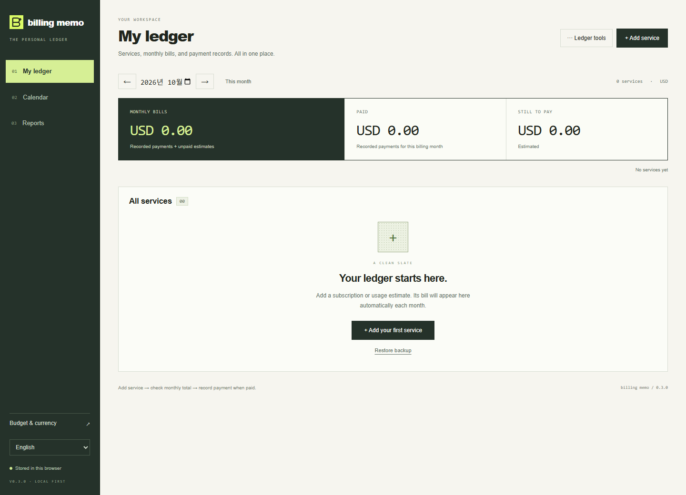

# Billing Memo

[English](README.md) · [한국어](README.ko.md) · [简体中文](README.zh-CN.md) · [日本語](README.ja.md) · [Español](README.es.md)

**모든 도구의 비용을, 하나의 장부로.** 클라우드·호스팅·DB·메일·API·구독 서비스의 지출을 관리하는 가벼운 로컬 장부입니다.

[Windows v0.3.0 다운로드](https://github.com/jeffrog-256k1/billing-memo/releases/latest) · [웹 앱 열기](https://jeffrog-256k1.github.io/billing-memo/) · [가상 데모 보기](https://jeffrog-256k1.github.io/billing-memo/?demo=1)



## 빈 장부에서 시작해, 한 화면에서 관리

1. 처음 실행하면 **빈 장부**가 열립니다. 데스크톱에는 데모 모드나 샘플 구독이 없습니다.
2. 서비스 이름·금액·통화·주기·첫 결제 기준일을 등록합니다. 결제 링크를 연결하고, 프로젝트·분류·메모는 필요할 때 펼쳐 입력합니다.
3. **내 장부**에서 항목 추가·편집, 조회 월 변경, 월 청구액·결제 완료액·남은 예상액 확인을 모두 처리합니다.
4. 납부 후 실제 금액을 기록합니다. **장부 도구 → JSON 백업 / 백업 복원**으로 데이터를 옮기거나 보관합니다.


웹도 기본은 빈 장부입니다. 가상 데모는 장부 도구에서 선택하거나 위 데모 링크로 열 때만 표시됩니다. 데모 수정은 임시이며 내 장부를 덮어쓰지 않습니다. **내 장부 열기**로 저장된 내 항목으로 돌아갑니다. 샘플 금액은 실제 요금이 아닙니다.

## 가벼운 Windows 앱

0.3부터 Electron 대신 **Tauri와 시스템 WebView2**를 사용합니다. 화면은 로컬 웹 UI이지만 Chromium·Node 실행 환경을 별도로 묶어 배포하지 않습니다. WebView2 설치 후에는 오프라인으로 실행됩니다. PC에 WebView2가 없거나 너무 오래된 경우 설치 프로그램이 별도로 내려받으므로 그 용량은 앱 설치 파일 크기에 포함되지 않습니다.

Windows 10/11 x64에서 설치 파일을 실행하거나 ZIP을 풀어 **Billing Memo.exe**를 실행하세요. ZIP도 WebView2가 필요합니다. 저장 위치는 **%APPDATA%/app.leejungjae.billingmemo/ledger.json**입니다. ZIP은 USB 안에 데이터를 보관하는 방식은 아닙니다. 서명되지 않은 배포라 Windows에서 게시자/SmartScreen 알림이 나올 수 있습니다. SHA256SUMS.txt로 파일 무결성을 확인할 수 있고 자동 업데이트는 없습니다.

**0.2에서 업데이트:** 기존 앱을 닫고 JSON 백업을 보관하세요. 새 앱 최초 실행 시 기존 기본 프로필의 저장된 장부를 복사해 가져옵니다. 이전 파일은 수정하지 않으며 가상 데모는 가져오지 않습니다. 자동 이전 실패 시 안내가 표시되고 JSON 복원으로 이어갈 수 있습니다. 기존 0.1/0.2 백업도 호환됩니다. [데스크톱 상세 안내](docs/DESKTOP.md)

## 세 개의 화면

- **내 장부:** 서비스 관리·월 청구액·결제 상태·결제 링크를 한곳에 표시합니다. 검색/분류/프로젝트/상태 필터, 월 예산, 접어 둔 6개월 전망을 제공합니다. 상단 월 합계는 목록 필터와 관계없이 전체 서비스 기준입니다.
- **결제 일정:** 납부 예정일, 날짜별 필터, 월 CSV, 미납 결제 ICS 캘린더를 제공합니다.
- **기간 분석:** 시작일~종료일(양 끝 포함)의 총액·월별 금액·평균, 프로젝트/분류 필터, 상세·월별 CSV를 제공합니다. 실제 결제일 또는 청구 예정일 기준을 선택합니다. 최대 120개월이며 평균에는 빈 달과 일부만 포함된 달도 들어갑니다.

## 계산과 데이터

월간·연간·일회성·사용량 비용을 지원합니다. 사용량은 API 자동 계측이 아닌 **월 합산 금액 직접 입력**입니다. 첫 결제 기준일에서 반복하며 31일 결제는 짧은 달의 말일에, 다음 달에는 다시 31일에 잡힙니다. 연간 비용은 청구 월에 전액 반영하고 정기 지출 월 환산에서만 12로 나눕니다.

월 청구액은 결제 완료 실제액과 미납 예상액의 합입니다. 1월 청구서를 2월에 납부했다면 내 장부에서는 1월, 실제 결제일 기준 기간 분석에서는 2월에 포함됩니다. 서비스 수정·일시정지·삭제 후에도 완료 기록은 유지됩니다. 수정은 과거를 포함한 미납 예상액에 반영됩니다. 서비스별 월 1건이며 추가 결제는 별도 일회성 항목으로 등록하세요.

USD·KRW·EUR·JPY·CNY·GBP 및 수동 환율을 지원합니다. 금액은 최소 화폐 단위의 정수로 저장하고 KRW/JPY는 소수점을 사용하지 않습니다. 환율 미입력 시 통화별 합계와 부분 환산 합계를 표시합니다. 표시 통화를 바꾸면 환율과 예산은 초기화됩니다. 자동 환율·과거 환율 조회는 없습니다.

데스크톱은 로컬 JSON, 웹은 해당 브라우저의 localStorage에 저장합니다. 계정·서버·자동 동기화는 없으며 웹과 앱 사이에는 JSON으로 옮기세요. 복원은 확인 후 대상 장부를 교체합니다. 브라우저 데이터 삭제는 웹 장부도 삭제합니다. 저장 실패나 손상 데이터는 경고하며 자동 초기화하지 않습니다.

서비스 500개, 완료 기록 5,000건, 장부/JSON 2MiB, 날짜 2000~2199년을 지원합니다. 메모 2,000자, 이름 80자, 건별 최대 1,000억 최소 화폐 단위입니다. HTTPS 링크만 허용합니다. 데이터와 내보낸 파일은 암호화되지 않습니다. 비밀번호·API 키·카드 정보를 입력하지 마세요. 직접 청구·자동 영수증 연동·백그라운드 알림은 제공하지 않으며 ICS 알림은 캘린더 앱에서 처리합니다.

## Development

Node.js 22.12+ and npm:

```sh
git clone https://github.com/jeffrog-256k1/billing-memo.git
cd billing-memo
npm ci
npm run dev
```

```sh
npm test
npm run build
npx playwright install chromium
npm run test:browser
npm run test:reports
npm run format:check
```

The local dev command builds and previews the production CSP; rerun after source changes. Windows builds also require stable Rust, MSVC C++ Build Tools and WebView2. See [desktop build instructions](docs/DESKTOP.md). No provider keys are needed.

[Contributing](CONTRIBUTING.md) · [Security](SECURITY.md) · [Dependencies](THIRD_PARTY_NOTICES.md)

Built by [jeffrog-256k1](https://github.com/jeffrog-256k1) · [leejungjae.app](https://leejungjae.app)
