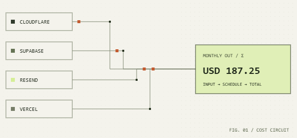
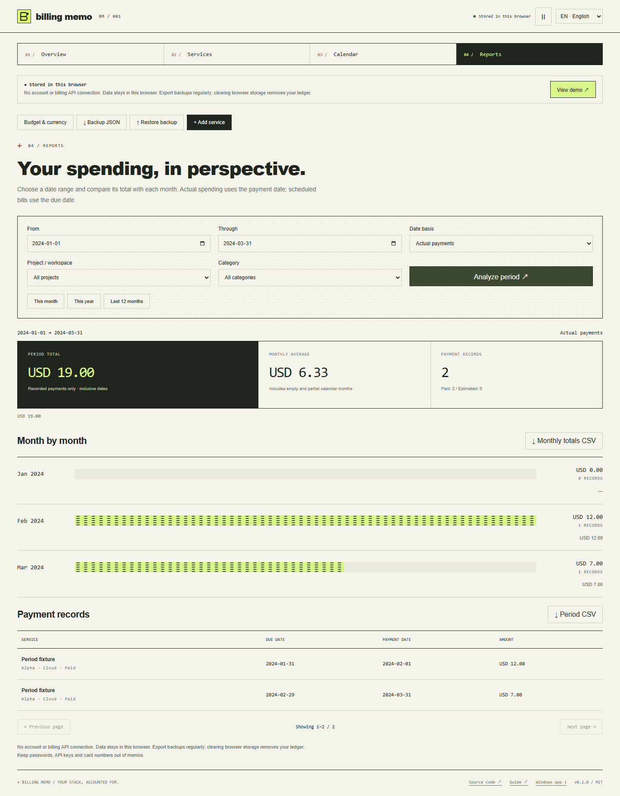
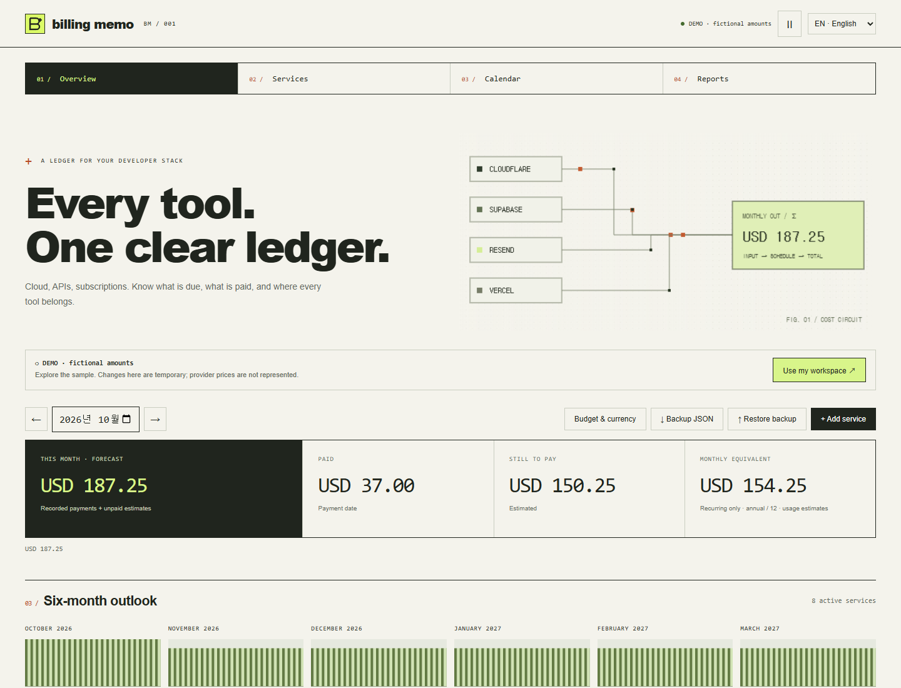

# Billing Memo

[English](README.md) · [한국어](README.ko.md) · [简体中文](README.zh-CN.md) · [日本語](README.ja.md) · [Español](README.es.md)

**Every tool. One clear ledger.** A browser-local notebook for the cost of your developer stack: cloud, hosting, databases, email, APIs and subscriptions.

[Open Billing Memo](https://jeffrog-256k1.github.io/billing-memo/) · [MIT](LICENSE) · [Changelog](CHANGELOG.md)



## Windows app · v0.2.0

[Download the Windows x64 installer or ZIP](https://github.com/jeffrog-256k1/billing-memo/releases/latest) · [Desktop guide](docs/DESKTOP.md)

Overview, Services, Calendar and Reports are now separate pages in both apps. **Reports** accepts inclusive start/end dates, shows the period total, monthly amounts and average, and filters by project or category. Choose **Actual payments** for recorded spending by payment date, or **Scheduled bills** for paid snapshots plus unpaid forecasts by due date. Export all matching details and monthly totals as CSV. Missing rates produce partial totals. Each query supports 120 calendar months; averages include empty and partial months.

Windows 10/11 x64: install the EXE, or extract the entire ZIP and run Billing Memo.exe. The app runs offline. Web and desktop ledgers are separate; transfer them with JSON backup/restore. Both desktop packages save under %APPDATA%/Billing Memo. The ZIP is installation-free, not USB-contained storage. This release is unsigned; Windows may display an unknown-publisher or SmartScreen warning. SHA-256 checksums are included.



## What you can do

- Keep service names, billing links, project labels, categories and memos together. Provider shortcuts fill names and links, never assumed prices.
- Track monthly, yearly, one-time and usage-based costs. Usage is a manually entered **monthly total**, not an API meter.
- See the selected month's forecast, recorded payments, remaining estimates and recurring monthly equivalent. Record the final amount when you pay.
- Filter by project, category, search or calendar day. Open any service's billing dashboard directly.
- Set a budget, see category distribution and a six-month outlook. Use USD, KRW, EUR, JPY, CNY or GBP, with optional manual conversion rates.
- Export a JSON backup, a monthly CSV or an unpaid-bills calendar with a three-day reminder. Restore validated JSON after a replacement confirmation.
- Use the complete interface in English, Korean, Simplified Chinese, Japanese or Spanish, on desktop or mobile. Pause circuit motion or honor reduced-motion preferences.



## Start with your own ledger

1. Explore the fictional demo, then choose **Use my workspace**. Demo edits are temporary and do not overwrite your ledger.
2. Add a service, its amount/currency and **first billing date**. That date anchors recurrence. Add an optional last billing date or pause unpaid estimates.
3. Select a month. **Record payment** replaces that service's estimate for that billing month with the actual amount, including zero.
4. Export backups regularly. Restore replaces the current workspace, so download your old backup first if needed.

## Calculation rules

Amounts are stored as integer minor units (KRW/JPY: zero decimals, others: two). A date such as January 31 becomes February's last day, then returns to March 31. Leap-day annual plans use February 28 in ordinary years. Annual charges count **in full in their billing month**; only the separate monthly equivalent divides them by 12. One-time charges do not enter the recurring equivalent.

Forecast = recorded actual amounts + unpaid estimates. Payments belong to their scheduled billing month; their actual payment date is stored separately. Overview and Calendar are planning views; Reports can instead group payments by actual payment date. Paid snapshots survive service edits, pauses and removal. Editing a service changes its unpaid estimates, including earlier months. Each service has one invoice per month; add separate one-time entries for individual extra transactions.

Different currencies remain separately totaled. A missing conversion rate is marked as a **partial total**, never silently treated as 1:1. Enter `1 source unit = N display units`; converted estimates are rounded per item to the display currency's minor unit. Changing display currency resets rates and budget. Rates are manual and have no automatic refresh. Future usage, taxes and provider price changes are not predicted; enter the full amounts you want to track.

## Storage and limits

No login, billing API integration, tracking or backend. The app makes no automatic third-party requests. Your own workspace is saved to this browser's localStorage; it is not encrypted and is shared with scripts on the same origin. Browser/site data deletion removes it, and private browsing is temporary. Self-host on a dedicated origin for separation. Do not store passwords, API keys or card details. Exports contain your entries: review them before sharing.

Limits: 500 services, 5,000 payment snapshots, 2 MiB serialized workspace/JSON import, names 80 characters, memos 2,000 characters, dates 2000–2199. Amounts must be nonnegative and at most 100 billion minor units per entry. Links must be HTTPS without embedded credentials. Multi-tab conflict detection prevents overwriting newer saves. Failed saves and unreadable stored data are reported, with export/recovery paths.

The app does not charge cards, sync devices, reconcile invoices or send background notifications. The exported calendar delegates its three-day reminders to your calendar app. Keep exported events in a dedicated calendar to manage updates or removals. Deleting a service keeps paid snapshots; removal can be undone immediately. Sample numbers are fictional, not current provider pricing.

## Run locally

Node.js 22.12+ and npm:

```sh
git clone https://github.com/jeffrog-256k1/billing-memo.git
cd billing-memo
npm ci
npm run dev
```

Open the local URL printed by Vite. `dev` builds and previews the static app with the production Content Security Policy; rerun after source changes. No secrets or environment file required.

```sh
npm test
npm run build
npx playwright install chromium
npm run test:browser
npm run test:reports
npm run format:check
```

`npm run render:assets` regenerates README media after building and browser tests. Browser tests use isolated fictional data. The published web app has no runtime package dependencies; the desktop edition bundles Electron; Vite/TypeScript, Playwright and gifenc are development tools.

[Contributing](CONTRIBUTING.md) · [Security](SECURITY.md) · [Dependencies](THIRD_PARTY_NOTICES.md)

Built by [jeffrog-256k1](https://github.com/jeffrog-256k1) · [leejungjae.app](https://leejungjae.app)
